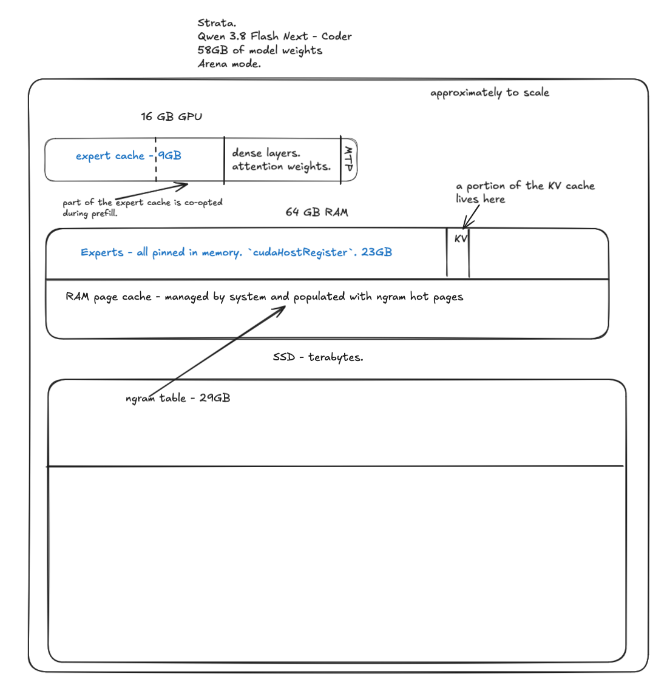

# Where the model lives: GPU, RAM, SSD

Qwen3.8 Flash-Next GSQ-RCO on a 16 GB VRAM frame, measured 2026-10-20 (Coder IQ1_M, RTX 3090, arena mode).

(`strata-mem-layout.excalidraw` is the source of the drawing.)

The model is two GGUF shards: shard 1 (29.6 GB for Coder) holds the experts, dense layers and attention; shard 2
(28.8 GB, the same file for every GSQ-RCO quant) is the n-gram table. The engine never holds all of it anywhere.

## GPU

| what | Coder, `--vram-reserve-mib 8700` on a 24 GB card |
|---|---|
| expert cache | 9.28 GiB, 4,881 slots: the experts ranked highest in `--expert-profile`, pre-filled at start |
| dense layers, attention weights | the non-expert part of shard 1 |
| MTP draft layer | 820 MiB (`--mtp`) |
| KV cache, resident part | `--kv-resident 32768` cells of the 131,072-cell context, rotated q4_0 |
| prompt path | borrows 2,223 of the cache's slots (4.18 GiB) during prefill; not extra memory |

`--vram-reserve-mib N` is the binding cap: the cache sizes itself to what is left, and `--expert-cache N` is
clamped to it. Peak during a 99k-token prompt: 16,024 MiB.

## RAM

What is in RAM depends on the expert mode. The cache in VRAM is the same in all three; the difference is where a
cache miss is served from.

| mode | flag | in RAM | a miss is |
|---|---|---|---|
| arena (default) | none | the whole expert set, page-locked with `cudaHostRegister` (23.4 GiB for Coder, ~30 GiB for IQ2_XS) | a DMA read over PCIe; the GPU computes every expert |
| resident | `--resident-experts` | only the complement of the GPU cache, page-locked (24 GiB for IQ2_XS at 7,389 slots) | the same, for what fits; the memory probe sizes the copy with 4 GiB of headroom |
| mmap | `--mmap-experts` | nothing on purpose; the shards are mapped and the page cache holds what was touched | a page fault on the decode path, computed by the CPU pool |

Two more residents in every mode: the KV cells that are not in VRAM, in 0.84 GiB of pinned RAM, streamed in on
demand; and the engine itself (about 2 GiB over the arena: 26.4 GiB RSS for Coder).

Measured on the same 3090 with 40 % of Coder's experts in VRAM: arena 67-99 tok/s decode, mmap 20 tok/s. The mmap
mode is for a machine whose GPU holds most of the experts; a 16 GB frame is not that machine.

`--resident-experts` falls back to mmap, silently, when the memory probe fails. It fails inside RunPod containers
(cgroup v1 with a hybrid `0::/docker/...` line, [issue #16](https://github.com/robertkarl/UnbiasedStrata/issues/16)).
The arena mode reads the limit through the memory guard instead and works there.

## SSD, and the page-cache trap

The n-gram table (shard 2, 28.8 GB) is read a few rows per token. `--ple-io direct`, the default, reads them
unbuffered: the table never occupies RAM. `--ple-io mmap` maps it and `--ple-io ram` copies it; both are for drives
too slow for the direct reads.

With `mmap`, the hot rows accumulate in the page cache, which is the strip at the bottom of the RAM box in the drawing.
On a box with RAM to spare that strip grows until the table's working set is in memory, and the run is no longer the
run of the machine it claims to be. The Coder run above, on a pod with a 125 GB cgroup, showed 25.5 GiB of RSS next to
65 GiB of page cache with 24 GiB of it mapped file pages; a 32 GB machine would have been evicting those pages and
faulting them back. Both runs were restarted with `--ple-io direct` (decode 47-50 tok/s on the pod, which is the honest
number).

Rules for a RAM-framed measurement:

1. Anonymous plus pinned memory is the frame. Page cache is not a free tier; read the cache and mapped-file columns of
   whatever samples the box before believing a RAM number.
2. `--ple-io direct`.
3. Arena or `--resident-experts`, never `--mmap-experts`, so the experts' cost shows up as RSS where the frame pays for
   it, not in latency.
4. Prefer a box whose RAM actually bounds the run (a VM sized to the frame); a cgroup you cannot shrink is observed,
   not enforced.

## Pre-built artifacts

The MTP draft directory (787 MB) is a deterministic product of `tools/mtp_fetch.py`, `tools/mtp_pack.py` and
`tools/mtp_rt.py`; three builds on two hosts produced byte-identical files. It and the expert profile for the
2026-10-17 Coder shard are at https://huggingface.co/robertkarl/UnbiasedStrataPacks, with the commands and hashes
in its README, so a new host copies them instead of fetching 5.2 GB of BF16 tensors and quantizing.
